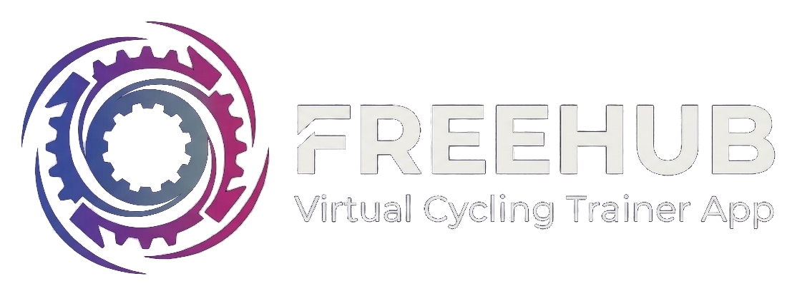

<p align="center"></p>

# Freehub — a minimal Zwift Hub app for macOS

Connects to a Zwift Hub over Bluetooth (standard FTMS), shows live power / cadence / speed / HR /
distance / time, records the ride and uploads it to Strava. No Zwift subscription needed.

## Requirements
- Node.js 18+ (`brew install node`)
- Google Chrome (Safari and Firefox don't support Web Bluetooth)
- Close Zwift/Companion app first — the Hub only accepts one connection at a time.

## Run
```bash
cd freehub
node server.js
```
Open http://localhost:3000 in Chrome → **Connect Zwift Hub** → **Start**.
A heart-rate strap can be paired separately with **Connect HR strap** (Zwift Hub has no HR sensor).

## Strava setup (one time, free)
1. Go to https://www.strava.com/settings/api and create an app.
   - Authorization Callback Domain: `localhost`
2. Create `config.json` next to `server.js`:
   ```json
   { "clientId": "12345", "clientSecret": "your_client_secret" }
   ```
3. Restart `node server.js`, click **Connect Strava**, approve.
4. After a ride: **Finish → Upload to Strava**. (Or **Download .tcx** and upload it manually.)

## Phone companion
Keep the dashboard tab open on your Mac and scan the QR code at the bottom of the dashboard with your phone camera
(the address is also printed in the terminal, e.g. `http://192.168.1.20:3000/companion`).
It must be on the same Wi-Fi. It mirrors the ride and can Start, Pause/Resume and Stop. After Stop you can
edit the Strava name, upload, resume or discard from the phone. Only the companion page and its control
endpoints are reachable from other devices; everything else (Strava, uploads) is Mac-only.

## Workouts (ERG mode)
Pick a workout in the Workout card and press **Start workout**. Targets are a percentage of your FTP (set it in the
panel below), the trainer holds each target power in ERG mode, and the app steps through the workout with beeps at each
change. You can **Skip step**, extend a step by a minute, or **End workout** (back to a flat free ride). The phone
companion shows the current target and has a Skip button. Included: ERG Check (10 min), Sweet Spot 3x8, 30/30 Intervals.
Pausing the ride pauses the workout clock. Workout names are used as the default Strava activity name.

## Session catalogue
The **Sessions** button (top left) opens your collection of workouts, with a small profile, length, IF and TSS for each.
**Use this session** loads it into the Workout card. **＋ New session** opens a builder: name it, add steps (minutes and
% of FTP, with optional ramps) or add a whole interval set in one go, and watch the profile update. Custom sessions are
saved in your browser (they stay after a refresh, but not across different browsers or computers). Built-in sessions can
be duplicated and edited as a custom copy.

## Ride image
After a ride is uploaded, the dialog shows a shareable image (ride name, stats, workout profile with your power over
it) with a **Download image** button. The image is 4:3 with safe margins, so Strava's feed crop and its "Virtual" badge don't cover anything. You can regenerate it for any past ride from History. Strava's public API can't attach photos, so add it on Strava with **Add photo**.

## Connection buttons
The Connect buttons turn green ("✓ Zwift Hub linked" / "✓ HR strap linked") when paired. Click a linked button to disconnect.

## History (saved rides)
Every ride is saved automatically in the `data/` folder next to `server.js` as soon as you press **Stop**
(discarding a ride deletes it). Click **⟲ History** to see weekly / monthly / all-time totals, open any ride,
re-download its Strava image or `.tcx`, rename it, upload it to Strava later, or delete it.

## Training plans
Click **📅 Plan** to start a template (e.g. the 4-Week FTP Builder) or build your own: pick a start date, the
number of weeks and a session for each day. The schedule shows what is Done, Today and Missed (matched against
your saved rides), and **Load** drops that day's session into the workout picker. A green dot on the button means
today's session is still to do. Plans and your custom sessions are stored in `data/`.

## Backing up
Everything you create lives in `data/` (`rides/`, `plans.json`, `custom.json`). Copy that folder to back it up.
Never share `config.json`, `tokens.json` or `data/` publicly.

## Desktop app (Mac and Windows)
Freehub can be packaged as a normal app with its own window, using Electron.

```bash
npm install          # once
npm run app          # run it as a desktop app without building
npm run dist:mac     # on a Mac  -> dist/Freehub-1.0.0-arm64.dmg (+ x64)
npm run dist:win     # on Windows -> dist/Freehub Setup 1.0.0.exe
```
- **Data:** the packaged app keeps rides, plans, `config.json` and `tokens.json` in its user-data folder
  (macOS `~/Library/Application Support/Freehub`, Windows `%APPDATA%\Freehub`). Use the **Freehub** menu →
  *Open data folder* or *Create config.json template for Strava*. `node server.js` still works as before.
- **Bluetooth:** Electron has no built-in device picker, so Freehub shows its own "Choose a device" window.
- **Signing and notarising (Mac):** with your Apple Developer ID Application certificate in your keychain, set
  `APPLE_ID`, `APPLE_APP_SPECIFIC_PASSWORD` and `APPLE_TEAM_ID` in the terminal, then run `npm run dist:mac`.
  electron-builder signs and notarises automatically. Without them it builds an unsigned app (right-click → Open).
- **Windows** builds are unsigned unless you add a code-signing certificate; Windows SmartScreen will say
  "unknown publisher" (More info → Run anyway).
- **Both at once:** push the project to GitHub and run the *Build Freehub* workflow (Actions tab). Add the secrets
  `MAC_CERT_P12_BASE64`, `MAC_CERT_PASSWORD`, `APPLE_ID`, `APPLE_APP_SPECIFIC_PASSWORD`, `APPLE_TEAM_ID` for a signed Mac build.

## Extras
- Power-zone colouring (set your FTP).
- ERG target power and free-ride mode via FTMS control (if your Hub firmware accepts it).
- Normalised power, 3 s power, energy, rolling 5-minute chart.
